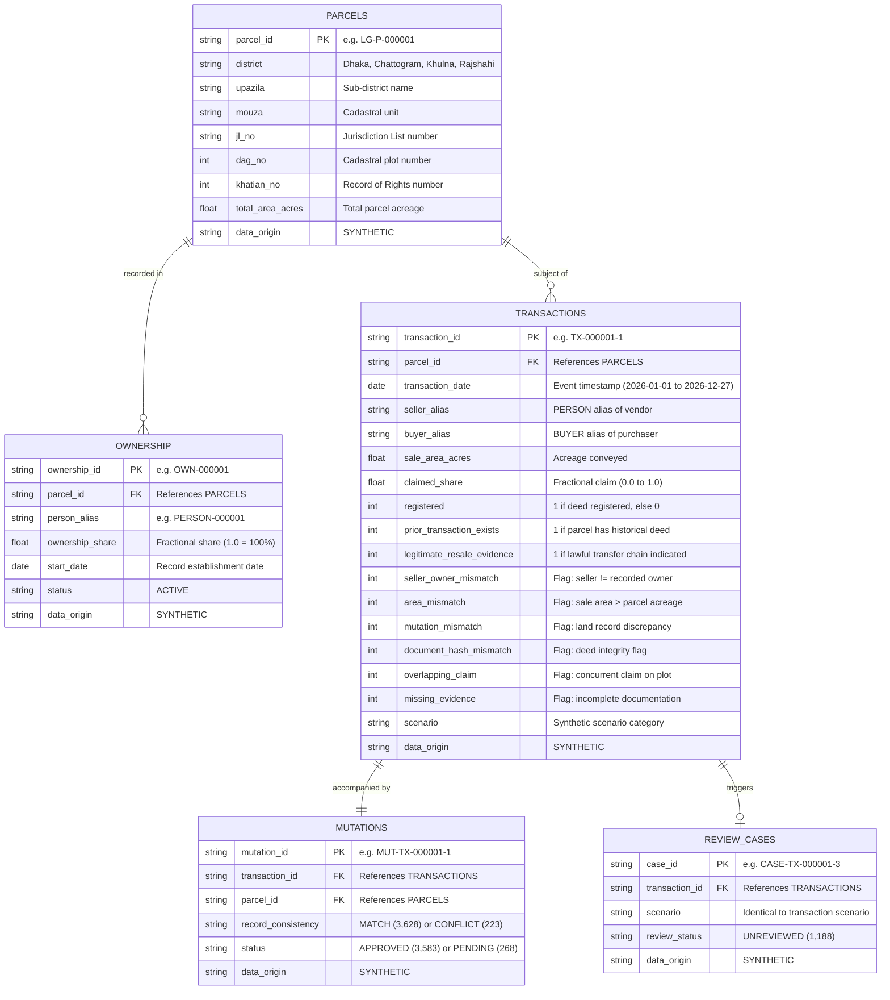
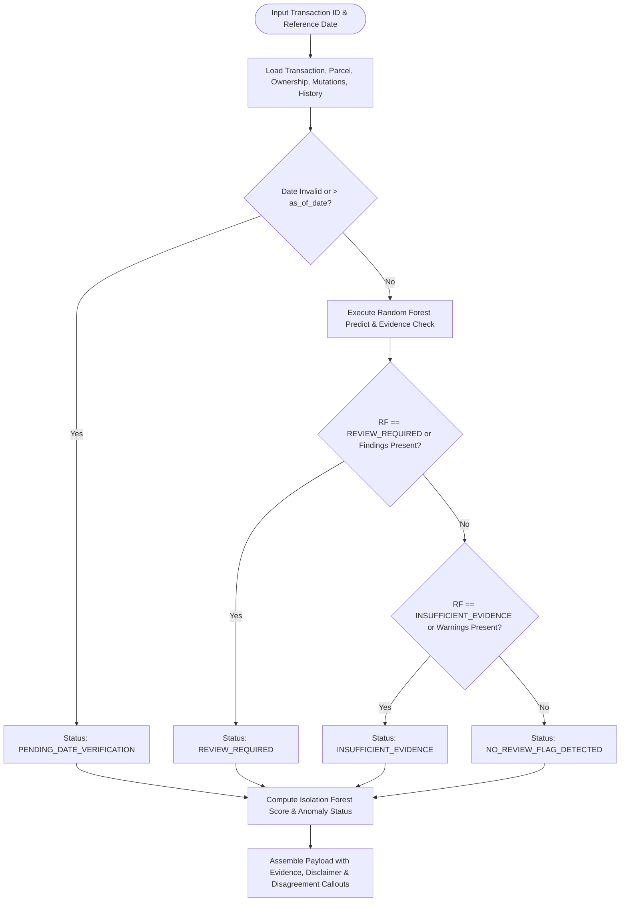
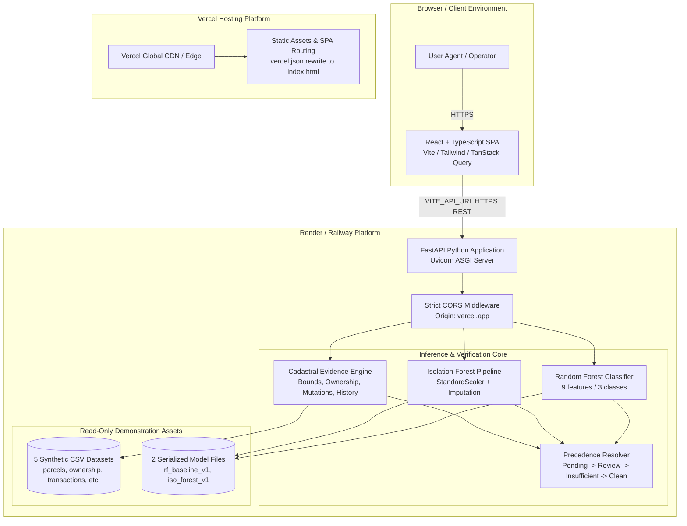
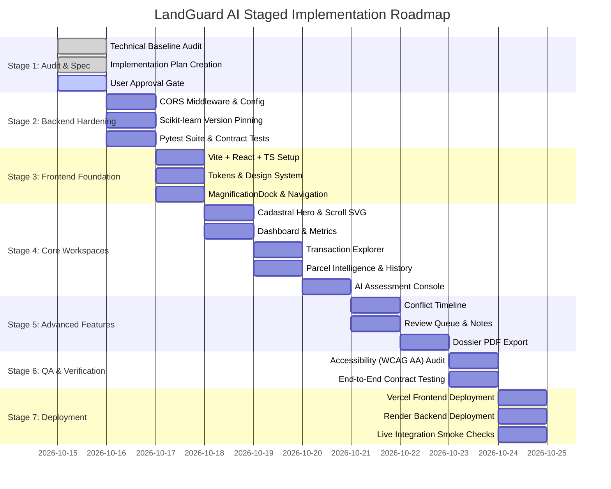

# LandGuard AI — Architectural Audit & Implementation Plan
**Document Version:** 1.0.0  
**Date:** October 15, 2026  
**Audience:** Hackathon Reviewers, Technical Architects, Development Team  
**Scope:** Full-Stack Architecture, ML Verification, Cadastral Intelligence Console, Vercel + Render Deployment  
**Data Integrity:** SYNTHETIC DATA ONLY — Screening Signals, Not Legal Fraud Determinations

---

## 1. Executive Summary & Audit Overview

LandGuard AI is an evidence-first cadastral intelligence workspace designed to screen synthetic land transactions for conflicting sales, inconsistent area claims, mutation anomalies, and ownership snapshot discrepancies.

As Lead Full-Stack Architect, this technical audit verified the existing Python FastAPI backend, five synthetic CSV datasets, and two trained machine learning model artifacts against the specifications in **SRS v1.1**.

### Key Audit Findings
1. **Model Integrity Verified:**
   - The Random Forest model (`landguard_rf_baseline_v1.joblib`) and Isolation Forest bundle (`landguard_isolation_forest_v1.joblib`) load and evaluate cleanly with expected features and outputs.
   - Acceptance test criteria **AC-04** was validated against live local models and data:
     - `TX-002911-1`: Correctly resolved as `INSUFFICIENT_EVIDENCE`
     - `TX-002911-2`: Correctly resolved as `REVIEW_REQUIRED`
     - `TX-002911-3`: Correctly resolved as `PENDING_DATE_VERIFICATION` (as of reference date `2026-10-15`)
2. **Backend Baseline Operational:**
   - 6 core FastAPI endpoints are functional (`/`, `/health`, `/dashboard/summary`, `/transactions`, `/transactions/{id}`, `/parcels/{id}/history`, `/assess/{id}`).
   - Error handling conforms to REST conventions (HTTP 404 for missing records, HTTP 422 for invalid pagination).
   - Missing dependencies (`fastapi`, `uvicorn`, `httpx`, `pytest`, `pydantic`) were identified in the host Python environment and verified.
   - InconsistentVersionWarning for scikit-learn (1.6.1 model vs 1.8.0 host) was identified; pinning `scikit-learn==1.6.1` in `backend/requirements.txt` is required for deployment stability.
3. **Dataset Structure & Provenance:**
   - 3,000 synthetic parcels evenly distributed across 4 administrative districts (Dhaka, Chattogram, Khulna, Rajshahi).
   - 3,851 transactions with 712 parcels featuring multiple historical transactions.
   - 1,188 synthetic review cases corresponding 1:1 with non-normal transaction scenarios.
4. **Target Deployment Topology:**
   - **Frontend:** React + TypeScript (Vite) Single Page Application hosted on **Vercel** with SPA rewrites (`vercel.json`) and dynamic API configuration via `VITE_API_URL`.
   - **Backend:** FastAPI + ML inference service deployed independently on **Render** (or Railway) with strict origin-based CORS.

---

## 2. Machine Learning Model Verification

### 2.1 Random Forest Classifier (`landguard_rf_baseline_v1.joblib`)
- **Model Type:** `sklearn.ensemble.RandomForestClassifier` (200 estimators).
- **Serialization Format:** Joblib pickle artifact.
- **Trained Classes (3):**
  1. `INSUFFICIENT_EVIDENCE`
  2. `NO_REVIEW_FLAG_DETECTED`
  3. `REVIEW_REQUIRED`
- **Strict Input Features (9):**
  ```python
  RF_FEATURES = [
      "registered",
      "prior_transaction_exists",
      "legitimate_resale_evidence",
      "seller_owner_mismatch",
      "area_mismatch",
      "mutation_mismatch",
      "document_hash_mismatch",
      "overlapping_claim",
      "missing_evidence"
  ]
  ```
- **Evaluation Rule:** Must be passed a 2D float DataFrame with strictly ordered column headers matching `RF_FEATURES`.
- **Constraint Compliance:** Model artifact will remain strictly read-only; no retraining or overwrite will occur.

### 2.2 Isolation Forest Anomaly Pipeline (`landguard_isolation_forest_v1.joblib`)
- **Bundle Format:** Python dictionary containing:
  - `pipeline`: Scikit-learn Pipeline with `StandardScaler` step and `IsolationForest(contamination=0.05, n_estimators=200, n_jobs=-1, random_state=42)` step.
  - `features`: Exactly 6 numeric dimensions:
    ```python
    ['sale_area_acres', 'claimed_share', 'transaction_month', 'transaction_day', 'prior_transaction_exists', 'legitimate_resale_evidence']
    ```
  - `train_medians`: Dictionary of training distribution medians for imputing missing/NaN features:
    ```python
    {
        'sale_area_acres': 0.713,
        'claimed_share': 0.5,
        'transaction_month': 6.0,
        'transaction_day': 14.0,
        'prior_transaction_exists': 0.0,
        'legitimate_resale_evidence': 0.0
    }
    ```
- **Operational Logic:**
  - Date decomposition: `transaction_month` and `transaction_day` extracted dynamically from `transaction_date`.
  - Imputation: Missing or unparseable values filled using `train_medians`.
  - Prediction: Binary label (`-1` = `ANOMALY`, `1` = `NORMAL_PATTERN`).
  - Score: Continuous float score via `decision_function()`. Negative values indicate greater deviation from the synthetic training baseline.
- **Decision Boundary Policy (MR-03):** Isolation Forest output is strictly supplementary. An anomaly score never independently labels a transaction as fraudulent or overrides a clean evidence verification.

---

## 3. Dataset Schemas & Relational Mapping

All data is synthetic and resides in `backend/data/`. Schemas and relationships were empirically verified:



### Dataset Distribution Metrics
| Dataset | Row Count | Distinct Key | Key Cardinality & Notes |
| :--- | :--- | :--- | :--- |
| `parcels.csv` | 3,000 | `parcel_id` | Exactly 750 parcels per district across 4 districts |
| `ownership.csv` | 3,000 | `ownership_id` | 1:1 active owner snapshot per parcel with 1.0 ownership share |
| `transactions.csv` | 3,851 | `transaction_id` | 2,288 parcels with 1 tx; 573 with 2 tx; 139 with 3 tx (712 multi-tx parcels) |
| `mutations.csv` | 3,851 | `mutation_id` | 1:1 transaction pairing; 223 CONFLICT records align with mutation_mismatch |
| `review_cases.csv` | 1,188 | `case_id` | Exactly covers all 1,188 flagged transaction scenarios (all UNREVIEWED) |

### Transaction Scenario Breakdown
- `normal`: 2,609 (67.7%)
- `owner_mismatch`: 282 (7.3%)
- `area_mismatch`: 226 (5.9%)
- `mutation_mismatch`: 223 (5.8%)
- `incomplete`: 195 (5.1%)
- `document_tamper`: 189 (4.9%)
- `conflicting_sale`: 73 (1.9%)
- `legitimate_resale`: 54 (1.4%)
- **Total:** 3,851 transactions

---

## 4. Assessment Precedence & Evidence Verification Engine

The core decision logic resides in `backend/app/main.py`. The evaluation follows a strict hierarchical policy:



### Deterministic Rule Checks (Evidence Engine)
1. **Cadastral Boundary Rule:** `sale_area_acres` must be $> 0$ and $\le total\_area\_acres + 10^{-4}$. Violation produces finding: *"Sale area outside recorded parcel bounds"*.
2. **Recorded Ownership Snapshot Rule:** Seller alias must exist in `ownership` table for `parcel_id` with `status == "ACTIVE"` and `start_date <= tx_date`. Violation produces finding: *"Seller not supported by available ownership snapshot"*.
3. **Claimed Share Rule:** `claimed_share` must not exceed recorded share $+ 10^{-4}$. Violation produces finding: *"Claimed share exceeds recorded ownership share"*.
4. **Mutation Integrity Rule:** Mutation record must exist with matching `parcel_id` and `record_consistency == "MATCH"`. Non-match produces finding: *"Mutation consistency mismatch"*. If status is not `APPROVED`, produces warning: *"Mutation is not approved"*.
5. **Historical Conflicting Sale Rule:** Chronological inspection of preceding transactions on the parcel. If the same seller sold to a different buyer previously:
   - If `legitimate_resale_evidence == 1`: warning *"Repeated seller transaction; resale evidence requires independent verification"*.
   - Else: finding *"Potential repeated sale to different buyers"*.
6. **Prior Overlapping Claim Warning:** If any prior transaction on the parcel had `overlapping_claim == 1`, produces warning: *"Previous overlapping claim indicator in parcel history"*.
7. **Flag Propagation:** Direct translation of synthetic indicator columns (`seller_owner_mismatch`, `area_mismatch`, `mutation_mismatch`, `document_hash_mismatch`, `overlapping_claim`) into human-readable findings.
8. **Disagreement Visibility (MR-06):** When Random Forest predicts `NO_REVIEW_FLAG_DETECTED` but evidence verification produces findings (e.g. `TX-002911-3`), the discrepancy is highlighted for human review rather than silenced.

---

## 5. Existing vs. New Features Gap Analysis

| Feature Area | Existing Backend Baseline | Required by SRS v1.1 | Action Required |
| :--- | :--- | :--- | :--- |
| **Public Landing Page** | None | FR-01: Cadastral hero, sample screening, scroll SVG journey | Build new React Landing experience |
| **System Summary** | `GET /dashboard/summary` | FR-02: Dashboard with scenario cards, multi-sale breakdown | Build rich interactive visual dashboard |
| **Transaction Explorer** | `GET /transactions` (search, limit, offset) | FR-03: Debounced search, sorting, column toggles, status pills | Build accessible data table with server pagination |
| **Parcel Intelligence** | `GET /parcels/{id}/history` | FR-04: Cadastral metadata, owner card, chronological history | Build parcel dossier view with plot dimensions |
| **AI Assessment View** | `GET /assess/{id}` | FR-05, FR-06: 3-column analysis, RF vs IF, rule breakdowns | Build Cadastral Assessment Console |
| **Conflict Timeline** | Raw history in `/parcels/{id}/history` | FR-07: Visual conflict chronogram, overlapping claim flags | Build interactive parcel timeline component |
| **Review Workspace** | `review_cases.csv` (read-only file) | FR-08: Case queue, filtering, annotations, status transitions | Phase 1: Client demo queue; Phase 2: Persisted API |
| **Audit PDF Report** | None | FR-09: Downloadable PDF with timestamp, hash, disclaimer | Implement client-side PDF export with printable styles |
| **Settings & Accessibility** | None | FR-10: Light/dark mode, reduced-motion toggle, demo disclaimer | Build Theme/Settings modal & state store |
| **Dock Navigation** | None | UX-02: MagnificationDock desktop launcher with tooltips | Implement Framer Motion responsive dock |
| **CORS Policy** | Unrestricted / default | SEC-03: Origin allowlist for Vercel production & preview | Configure FastAPI CORSMiddleware |
| **Backend Testing** | Manual Colab tests | AC-01 to AC-10: Automated Pytest suite | Add `tests/test_api.py` in backend |

---

## 6. Frontend Architecture & Design Specification

### 6.1 Design Concept: "Cadastral Intelligence Console"
A visual aesthetic rooted in land survey cartography, archival ledger typography, and forensic document analysis. Avoid generic floating gradient cards or neon glow.

#### Design Tokens (`frontend/src/styles/tokens.css`):
```css
:root {
  --color-ink: #172C32;          /* Deep primary slate/ink */
  --color-paper: #F7F8F4;        /* Warm light canvas */
  --color-survey-teal: #157C78;  /* Primary brand & cadastral accent */
  --color-survey-teal-hover: #116461;
  --color-evidence-amber: #B66D23;/* Caution / Insufficient evidence */
  --color-record-blue: #426B85;  /* Ledger blue / Informational */
  --color-alert-red: #B74445;    /* Review required / Discrepancy */
  --color-border: #D8DDD5;       /* Crisp cadastral grid line */
  --color-surface: #FFFFFF;      /* Primary card surface */
  --color-surface-subtle: #EFF1EB;
  --font-sans: 'Plus Jakarta Sans', system-ui, sans-serif;
  --font-mono: 'IBM Plex Mono', monospace;
  --radius-sm: 6px;
  --radius-md: 8px;
  --radius-lg: 12px;
}

[data-theme="dark"] {
  --color-ink: #F0F4F4;
  --color-paper: #0E1719;
  --color-survey-teal: #229D98;
  --color-survey-teal-hover: #29B3AD;
  --color-evidence-amber: #D98836;
  --color-record-blue: #5C8EAE;
  --color-alert-red: #D95D5E;
  --color-border: #223338;
  --color-surface: #152226;
  --color-surface-subtle: #1A2B30;
}
```

### 6.2 Frontend Technology Stack
- **Framework:** React 18+ with TypeScript (strict configuration)
- **Build Tool:** Vite
- **Styling:** Vanilla CSS design tokens + Tailwind CSS for utility layout
- **Routing:** React Router v6 (browser history with Vercel catch-all rewrites)
- **Data Fetching & Caching:** TanStack Query (React Query) with typed REST client
- **Icons:** Lucide React
- **Data Visualization:** Recharts (cadastral breakdown, scenario distribution)
- **Motion & Micro-interactions:** Framer Motion (MagnificationDock, scroll SVG path draw, collapsible transitions)
- **PDF Generation:** `@react-pdf/renderer` or `jspdf` + `html2canvas` for client-side forensic dossier generation

### 6.3 Frontend Directory Structure
```
frontend/
├── index.html
├── package.json
├── tsconfig.json
├── vite.config.ts
├── vercel.json
├── public/
│   └── favicon.svg
└── src/
    ├── main.tsx
    ├── App.tsx
    ├── styles/
    │   ├── index.css
    │   └── tokens.css
    ├── types/
    │   ├── api.ts
    │   ├── parcel.ts
    │   ├── transaction.ts
    │   └── assessment.ts
    ├── lib/
    │   ├── api.ts              # Typed Axios/Fetch client
    │   └── utils.ts            # Formatting, date parsing, styling utils
    ├── components/
    │   ├── layout/
    │   │   ├── Navbar.tsx
    │   │   ├── Sidebar.tsx
    │   │   ├── MagnificationDock.tsx
    │   │   └── DisclaimerBanner.tsx
    │   ├── ui/
    │   │   ├── Badge.tsx
    │   │   ├── Button.tsx
    │   │   ├── Card.tsx
    │   │   ├── Table.tsx
    │   │   ├── Modal.tsx
    │   │   └── Skeleton.tsx
    │   ├── landing/
    │   │   ├── HeroCadastral.tsx
    │   │   ├── ScrollConnector.tsx
    │   │   └── SampleAssessment.tsx
    │   ├── assessment/
    │   │   ├── StatusHeader.tsx
    │   │   ├── ModelScoresCard.tsx
    │   │   ├── EvidenceRulesList.tsx
    │   │   └── DiscrepancyCallout.tsx
    │   ├── parcel/
    │   │   ├── CadastralCard.tsx
    │   │   ├── ConflictTimeline.tsx
    │   │   └── OwnershipSnapshot.tsx
    │   └── reports/
    │       └── AssessmentReportModal.tsx
    └── pages/
        ├── LandingPage.tsx
        ├── DashboardPage.tsx
        ├── TransactionsPage.tsx
        ├── TransactionDetailPage.tsx
        ├── ParcelDetailPage.tsx
        ├── ReviewQueuePage.tsx
        └── SettingsPage.tsx
```

---

## 7. System Architecture & Topology



---

## 8. Deployment Architecture: Vercel & Render

### 8.1 Frontend Deployment (Vercel)
- **Deployment Model:** Single Page Application (Static generation via `npm run build`).
- **Vercel Settings:**
  - **Framework Preset:** Vite
  - **Root Directory:** `frontend`
  - **Build Command:** `npm run build`
  - **Output Directory:** `dist`
  - **Node.js Version:** 20.x
- **Environment Variables:**
  - `VITE_API_URL`: `https://landguard-backend.onrender.com` (no trailing slash)
  - *(Note: All `VITE_*` variables are bundled into client JavaScript at build time. No secrets or private tokens will be stored here).*
- **SPA Routing (`frontend/vercel.json`):**
  ```json
  {
    "rewrites": [
      {
        "source": "/(.*)",
        "destination": "/index.html"
      }
    ]
  }
  ```
- **Vite Configuration (`frontend/vite.config.ts`):**
  - Set `base: "/"` for proper root-level asset resolution.

### 8.2 Backend Deployment (Render / Railway)
- **Deployment Model:** Web Service (Native Python runtime).
- **Render Settings:**
  - **Environment:** Python 3.11
  - **Root Directory:** `backend`
  - **Build Command:** `pip install -r requirements.txt`
  - **Start Command:** `uvicorn app.main:app --host 0.0.0.0 --port $PORT`
  - **Health Check Path:** `/health`
- **Environment Variables:**
  - `ALLOWED_ORIGINS`: `https://<your-project>.vercel.app,http://localhost:5173`
  - `PORT`: 10000 (standard Render auto-assigned port)
- **Asset Packaging:**
  - `backend/data/*.csv` and `backend/models/*.joblib` are bundled directly into the container filesystem.
  - Read-only operations ensure cold-start efficiency without persistent volume requirements.

---

## 9. Security, CORS, Governance & Testing Requirements

### 9.1 Security & Ethics Governance
- **SEC-01 (Synthetic Only):** All displayed identifiers, aliases (`PERSON-XXXX`, `BUYER-XXXX`), and land plot metrics are entirely synthetic. The system displays a visible persistent disclaimer:
  > *"Synthetic demonstration workspace — screening signals and review recommendations only. Does not prove legal title or fraudulent intent."*
- **SEC-02 (Credential Isolation):** No API keys, database passwords, or operational secrets committed to git.
- **SEC-03 (Origin CORS Policy):**
  ```python
  from fastapi.middleware.cors import CORSMiddleware
  import os

  allowed = os.getenv("ALLOWED_ORIGINS", "http://localhost:5173,http://127.0.0.1:5173").split(",")
  app.add_middleware(
      CORSMiddleware,
      allow_origins=allowed,
      allow_credentials=True,
      allow_methods=["GET", "POST", "PATCH", "OPTIONS"],
      allow_headers=["*"],
  )
  ```
- **SEC-06 (Pickle/Joblib Safety):** Models loaded only from local application assets; no untrusted upload endpoints.
- **SEC-07 (Audit Logging):** Log request latencies, endpoint accesses, and assessment results without personally identifiable citizen data.

### 9.2 Quality Assurance & Testing Matrix
1. **Unit & Contract Testing (Backend):**
   - Health check (`/health` returns status `ok`, models: 2, datasets: 5).
   - Summary integrity (`/dashboard/summary` matches exact CSV row counts).
   - Pagination boundaries (limit clamped between 1 and 100, offset $\ge 0$, returns 422 for negative inputs).
   - Record lookup (valid ID returns 200, unknown returns 404).
   - Assessment precedence rules tested against reference cases (`TX-002911-1`, `TX-002911-2`, `TX-002911-3`).
2. **Frontend Quality & Accessibility (WCAG 2.1 AA):**
   - TypeScript strict mode (`tsc --noEmit`).
   - Color contrast ratios $\ge 4.5:1$ for normal text, $\ge 3:1$ for large text and UI components.
   - Screen-reader ARIA live regions for dynamically loaded search results and assessment statuses.
   - Visible keyboard `:focus-visible` styling on all interactive elements.
   - Full support for `prefers-reduced-motion` media queries on Framer Motion animations and SVG paths.
   - Responsive viewport verification across 320px (mobile), 768px (tablet), 1024px (desktop), and 1440px+ (ultra-wide).

---

## 10. Phased Implementation Roadmap



### Next Immediate Action Items (Upon User Approval)
1. **Backend CORS & Requirements Adjustment:**
   - Update `backend/requirements.txt` to pin `scikit-learn==1.6.1`.
   - Update `backend/app/main.py` with `CORSMiddleware` reading allowed origins from environment variable.
   - Create automated pytest suite `backend/tests/test_api.py`.
2. **Frontend Scaffold Creation:**
   - Initialize Vite + React + TypeScript project under `frontend/`.
   - Install dependencies (`tailwindcss`, `lucide-react`, `framer-motion`, `@tanstack/react-query`, `recharts`, `react-router-dom`).
   - Configure `vercel.json`, `tokens.css`, and typed API client (`frontend/src/lib/api.ts`).

---
*End of Implementation Plan — Awaiting User Approval to Proceed to Implementation.*
