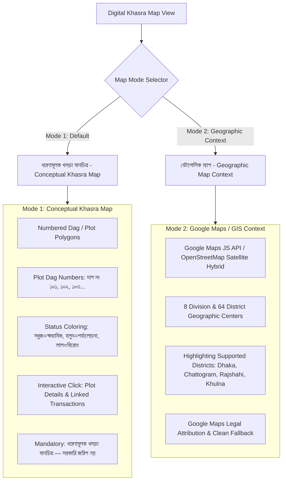

# LANDGUARD AI — DIGITAL KHASRA & GEOGRAPHIC MAP SPECIFICATION

**Module:** Digital Khasra / Cadastral Plot Map & Google Maps Context  
**Inspiration:** Reference Screenshots 3 & 4 (Numbered Khasra plots & boundary overlays)  
**Standard:** Synthetic LandTech Visualization & Non-Government Disclaimer  

---

## 1. Dual-Mode Map Architecture

LandGuard AI provides two complementary map modes:

---

## 2. Mode 1 — Conceptual Khasra Map (Schematic Plot Layout)

### Design & Layout (Inspired by Reference 3 & 4)
- Plots are rendered as clear geometric polygon parcels arranged in a realistic Mouza layout.
- Each parcel block shows:
  - **দাগ নম্বর (Dag Number):** e.g., `১০১`, `১০২`, `১০৩`, `১০৪`.
  - **জমির পরিমাণ (Area in Acres):** e.g., `০.৩৫ একর`.
  - **স্ট্যাটাস ইন্ডিকেটর (Status Color):** Emerald (স্বাভাবিক), Amber (পর্যালোচনা প্রয়োজন), Rose (মালিকানা অসংগতি).
- Clicking any parcel immediately opens the **Parcel Intelligence Drawer** showing:
  - Parcel ID (`PARCEL-002911`)
  - খতিয়ান নম্বর (Khatian No.)
  - জেলা ও উপজেলা (District & Upazila)
  - সংশ্লিষ্ট লেনদেনসমূহ (Linked Transactions)
  - RMD ধারাবাহিকতা স্ট্যাটাস (RMD Triangulation Status)
- Prominent persistent banner:
  > **"ধারণামূলক খসড়া মানচিত্র — সরকারি জরিপ নয়"**  
  > *(This schematic plot diagram is for demonstration and decision-support only; it is not an official cadastral survey.)*

---

## 3. Mode 2 — Geographic Map Context (Google Maps & GIS)

- Uses Google Maps JavaScript API with graceful fallback to OpenStreetMap / Leaflet tile layers when no API key is set in `VITE_GOOGLE_MAPS_API_KEY`.
- Correctly displays division markers and district boundaries across Bangladesh.
- Highlights the four synthetic data districts (Dhaka, Chattogram, Rajshahi, Khulna) with clickable badges that jump directly to their supported Mouza records.
- Accessible zoom, pan, full-screen, and reset controls with full touch responsiveness.
