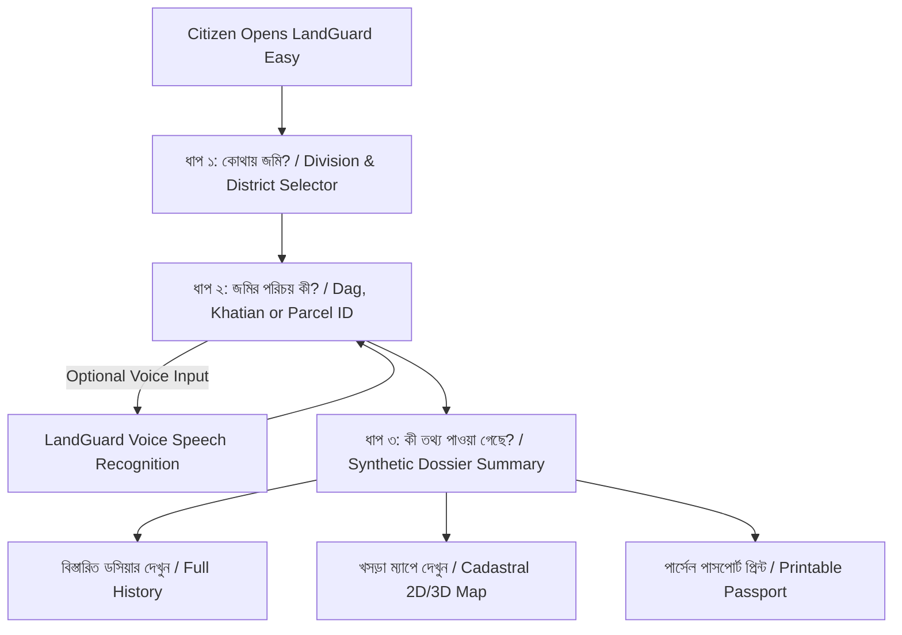

# LANDGUARD EASY — USER JOURNEY & SPECIFICATION

## 1. Overview & Human-Centered Philosophy
**LandGuard Easy (সহজ মোড)** is designed to democratize land record screening across Bangladesh. Traditional land systems require knowledge of complex cadastral terms (CS, SA, RS, BS, Porcha, Khatian, Dag, Mutation, Dakhila) and dense bureaucratic workflows.

LandGuard Easy establishes a **guided 3-step citizen journey**:
1. **No educational background declaration** required.
2. Large, high-contrast touch targets (minimum 48px).
3. Plain-language Bengali instructions accompanied by voice assistance and text-to-speech audio playback.
4. Seamless transition to **Advanced Mode ("উন্নত ফিল্টার")** on demand.

---

## 2. The 3-Step Guided Citizen Journey

### STEP 1: কোথায় জমি? (Geographic Anchor)
- **Visual division grid**: Large, responsive cards for all 8 divisions (Dhaka, Chattogram, Rajshahi, Khulna, Barishal, Sylhet, Rangpur, Mymensingh).
- **Synthetic Data Indicators**: Clear badges indicating supported demonstration districts (e.g., `সাভার, ঢাকা`, `পাহাড়তলী, চট্টগ্রাম`, `পবা, রাজশাহী`, `রূপসা, খুলনা`).
- **Default Guidance**: Contextual advice providing a one-click sample anchor (`ঢাকা > সাভার`) so users are never blocked.
- **Audio Prompt**: Read-aloud button reads: *"ধাপ ১: আপনার বিভাগ ও জেলা নির্বাচন করুন।"*

### STEP 2: জমির পরিচয় কী? (Parcel Identification)
- **High-contrast Input Box**: Dedicated search box accepting Dag numbers (e.g., `১০২`), Khatian numbers (e.g., `KH-102`), or Parcel IDs (`LG-P-002911`).
- **Voice Input Button**: Microphone button with live recording status ("শুনছি..."), transcript confirmation, and hands-free input.
- **One-Touch Sample Chips**:
  - `সাভারের দাগ ১০২ (LG-P-002911)`
  - `পাহাড়তলীর দাগ ২০৫ (LG-P-000104)`
  - `নওহাটার দাগ ৩১০ (LG-P-001420)`
- **Audio Prompt**: *"ধাপ ২: আপনার জমির দাগ নম্বর বা খতিয়ান নম্বর লিখুন অথবা নিচের নমুনা বোতামে চাপুন।"*

### STEP 3: কী তথ্য পাওয়া গেছে? (Plain-Language Results)
- **Human-Readable Cards**:
  - জমির পরিচয়: `LG-P-002911`
  - দাগ নং: `১০২` • খতিয়ান নং: `KH-102`
  - অবস্থান: `ঢাকা > সাভার > আমিনবাজার`
  - আয়তন: `০.৫৫ একর`
  - স্ক্রিনিং অবস্থা: `পর্যালোচনা প্রয়োজন (Review Required)`
- **Explanation Box**:
  - *"পূর্ববর্তী দলিলের তারিখ ও মিউটেশন রেকর্ডে অসংগতি থাকায় যাচাই প্রয়োজন।"*
- **Action Pathways**:
  - `বিস্তারিত ডসিয়ার দেখুন` &rarr; Navigates to `/parcels/LG-P-002911`.
  - `খসড়া ম্যাপে প্লট দেখুন` &rarr; Navigates to `/khasra-map`.
  - `অন্য দাগ নম্বর দিন` &rarr; Returns to Step 2.

---

## 3. Accessibility & Inclusivity Verification
- **Contrast Ratios**: Body text meets WCAG AAA standards (> 7:1) using Greenfield `#062B22` background and `#F5F8F2` / `#C4E8A5` typography.
- **Screen Reader Labels**: Every button, input, and interactive badge has explicit `aria-label` or visible text.
- **No Floating Jargon**: Terms like `isolation_forest_decision_score` are hidden in Simple Mode and accessible only via the expandable technical accordion.
