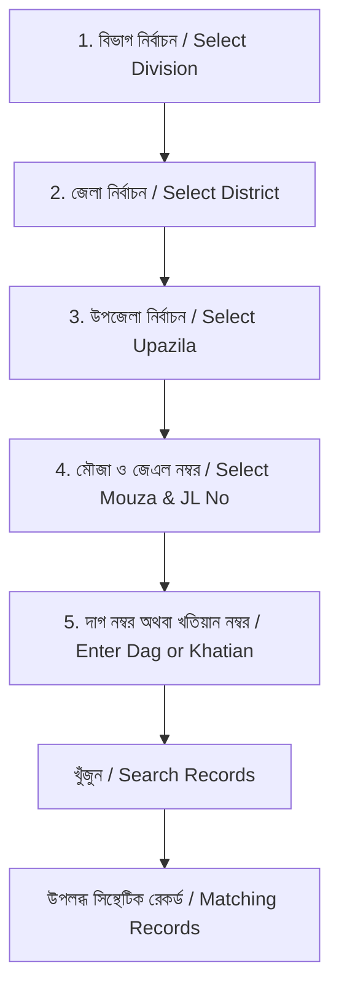

# LANDGUARD AI — GUIDED LAND SEARCH & TRANSACTION WORKFLOW

**Standard:** Simple, cascading, accessible land record discovery.  
**Inspiration:** Reference Screenshot 1 (Bangladesh Land Service Search Form).  

---

## 1. Cascading Geographic Selector Hierarchy

### Supported Geographic Coverage in Synthetic Baseline:
- **ঢাকা বিভাগ (Dhaka Division):**
  - জেলা: `Dhaka`, উপজেলা: `Savar`, মৌজা: `Aminbazar` (JL 45)
- **চট্টগ্রাম বিভাগ (Chattogram Division):**
  - জেলা: `Chattogram`, উপজেলা: `Pahartali`, মৌজা: `North Kattali` (JL 12)
- **রাজশাহী বিভাগ (Rajshahi Division):**
  - জেলা: `Rajshahi`, উপজেলা: `Paba`, মৌজা: `Nowhata` (JL 08)
- **খুলনা বিভাগ (Khulna Division):**
  - জেলা: `Khulna`, উপজেলা: `Rupsha`, মৌজা: `Naihati` (JL 23)

*Note: For the remaining 60 districts of Bangladesh, the search form displays a helpful informational notice: "এই জেলাটির জন্য বর্তমানে কোনো সিন্থেটিক রেকর্ড সংযুক্ত নেই। ডেমো অনুসন্ধানের জন্য ঢাকা, চট্টগ্রাম, রাজশাহী বা খুলনা জেলা নির্বাচন করুন।"*

---

## 2. Nine-Step Citizen Transaction Journey

1. **Find Land (জমি খুঁজুন):** Search by location, Dag, Khatian, or Parcel ID.
2. **Review Parcel Details (জমির খতিয়ান ও পরিমাপ):** Recorded area, district, khatian status.
3. **Select a Transaction (লেনদেন নির্বাচন):** Chronological table of registered deeds.
4. **Check Available Evidence (নথি ও প্রমাণের তথ্য):** Seller identity, mutation status, area consistency.
5. **Run AI-Assisted Assessment (AI দ্বারা যাচাই):** Evaluates risk without modifying datasets.
6. **Plain Language Explanation (ফলাফল ও ব্যাখ্যা):** Clear categorization into 4 plain statuses.
7. **RMD Triangulation Audit (RMD অডিট):** Khatian vs Mutation vs Deed consistency card.
8. **Request Review / Help (পর্যালোচনা বা সহায়তা):** Send for caseworker triage or ask AI Copilot.
9. **Download Cadastral Dossier (প্রতিবেদন ডাউনলোড):** Clean ReportLab PDF with synthetic disclaimer.
