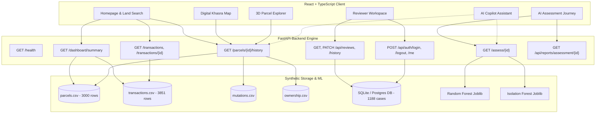

# LANDGUARD AI — MASTER EXISTING SYSTEM AUDIT & FEATURE INVENTORY

**Date:** 2026-10-16  
**Auditor:** Principal Full-Stack Architect, AI Systems Engineer, & Lead Product Designer  
**Scope:** Complete Codebase, APIs, ML Models, Datasets, UI/UX Components, Security & Deployments  

---

## 1. Executive Summary

This master audit evaluates the current state of **LandGuard AI** across its frontend (React + TypeScript + Vite), backend (FastAPI + Scikit-Learn), synthetic datasets, security mechanisms, and deployment pipelines. The objective is to establish an unvarnished, accurate technical baseline before executing the **LandGuard Greenfield** user-centric transformation.

### Key Audit Findings:
1. **Product Complexity Mismatch:** The current UI is styled as a dark, futuristic cyber-intelligence command center. It is visually overwhelming and inappropriate for ordinary citizens, landholders, and users with low digital literacy.
2. **Language Default:** The interface currently defaults to English (`en`) instead of Bengali (`bn`), violating the Bangladesh-first principle.
3. **Absence of RMD Definition:** A comprehensive grep across the entire source code, dataset files, and SRS documentation confirmed **zero occurrences of the acronym "RMD"**. Per user instructions in PART 12, this must be explicitly clarified by the user before any RMD module is constructed.
4. **Data Coverage Boundary:** The synthetic `parcels.csv` dataset contains 3,000 parcels across 4 specific districts: **Dhaka, Chattogram, Rajshahi, and Khulna** (each with 1 sample Upazila and Mouza). The UI must clearly indicate this boundary rather than fabricating records for the other 60 districts.
5. **Backend Health & Verification:** All 27 automated tests are passing, live Render backend health check returns `200 OK` (2 models, 5 datasets loaded), and ground-truth benchmark assessments (`TX-002911-1`, `TX-002911-2`, `TX-002911-3`) execute accurately.

---

## 2. Complete Feature Inventory & Classification

Each existing feature is classified according to the required schema:
- **[F]** Fully implemented & tested
- **[D]** Implemented but defective (visual/usability/routing defect)
- **[P]** Partially implemented
- **[M]** Missing
- **[B]** Requires additional backend support
- **[G]** Requires verified geographic data
- **[C]** Requires user clarification

| Feature / Module | Current Classification | Detailed Technical Audit Observations |
| :--- | :---: | :--- |
| **Landing & Homepage** | **[D]** Implemented but defective | Current entry point (`/`) loads the complex analytical dashboard with cyber graphs, dark KPI counters, and technical charts. Completely lacks the welcoming, agricultural land-service layout inspired by Reference 2. |
| **Language Toggle (i18n)** | **[D]** Implemented but defective | `i18n.ts` is configured with `en` and `bn`, but defaults to `en`. Bengali translations exist in `locales/bn.json` but some technical phrases remain untranslated or awkward. |
| **Guest Demo Mode** | **[P]** Partially implemented | Users can access the frontend without logging in, but there is no dedicated, friendly "ডেমো ব্যবহার করুন" banner or explanation of what guest access entails. |
| **Simple Land Search** | **[D]** Implemented but defective | Transaction Explorer search only filters by `transaction_id` text and scenario dropdown. Missing cascading Division &rarr; District &rarr; Upazila &rarr; Mouza &rarr; Dag/Khatian search wizard inspired by Reference 1. |
| **Digital Khasra Map** | **[P] / [G]** Partial & Geo-restricted | `CadastralMap.tsx` renders Leaflet tiles and stylized synthetic parcel polygons, but lacks official Google Maps integration, numbered Dag/Khasra plot layouts inspired by Reference 3 & 4, and clear "ধারণামূলক খসড়া মানচিত্র — সরকারি জরিপ নয়" schematic disclaimer. |
| **3D Parcel Explorer** | **[F]** Fully implemented & tested | Three.js / React Three Fiber interactive cadastral viewer with plot extrusions, hover labels, and wireframes works in `Explorer3DPage.tsx`. Requires optimization for reduced motion and low-spec mobile devices. |
| **AI Assessment Engine** | **[F]** Fully implemented & tested | Random Forest (`landguard_rf_baseline_v1.joblib`) and Isolation Forest (`landguard_isolation_forest_v1.joblib`) return consistent predictions on `/assess/{tx_id}`. Benchmark cases strictly match. |
| **Transaction History Flow** | **[F]** Fully implemented & tested | Endpoints `/transactions` and `/transactions/{id}` support pagination, filtering, and evidence flags (`seller_owner_mismatch`, `mutation_mismatch`, etc.). UI is too technical for citizens. |
| **Review Workspace (Admin)** | **[F]** Fully implemented & tested | SQLite on `/data` persistent storage / PostgreSQL dual driver. Status updates (`APPROVED`, `REJECTED`, `IN_REVIEW`), reviewer notes, and audit history persist durably. |
| **PDF Dossier Generation** | **[F]** Fully implemented & tested | ReportLab generates binary PDF streams on `/api/reports/assessment/{id}` with official cadastral formatting, disclaimers, and evidence breakdowns. |
| **Authentication & RBAC** | **[F]** Fully implemented & tested | Argon2id KDF password hashing, session tokens, role checks (`reviewer`, `admin`). Exposed demo accounts revoked in production mode. |
| **AI Copilot** | **[M]** Missing | No interactive AI Copilot currently exists in the frontend. Needs a Bengali-first conversational assistant grounded in synthetic records with safe client/server boundary. |
| **RMD Module** | **[C]** Requires user clarification | Unmentioned in SRS and codebase. Awaiting user clarification on full form and functionality before engineering. |
| **User Registration** | **[M]** Missing | Only pre-provisioned reviewer/admin authentication exists. Public citizen user registration and profile management are not yet implemented. |

---

## 3. API Dependency Map & Backend Contracts

---

## 4. Source-of-Truth Datasets

All datasets reside in `backend/data/` and must remain immutable:

1. **`parcels.csv` (3,000 records, 207 KB):**
   - Columns: `parcel_id`, `district`, `upazila`, `mouza`, `jl_no`, `dag_no`, `khatian_no`, `total_area_acres`, `data_origin`
   - Geographic coverage: **Dhaka, Chattogram, Rajshahi, Khulna**
2. **`transactions.csv` (3,851 records, 435 KB):**
   - Columns: `transaction_id`, `parcel_id`, `transaction_date`, `seller_alias`, `buyer_alias`, `sale_area_acres`, `claimed_share`, `registered`, `prior_transaction_exists`, `legitimate_resale_evidence`, `seller_owner_mismatch`, `area_mismatch`, `mutation_mismatch`, `document_hash_mismatch`, `overlapping_claim`, `missing_evidence`, `scenario`, `data_origin`
3. **`mutations.csv` (254 KB):**
   - Columns: `mutation_id`, `transaction_id`, `parcel_id`, `record_consistency`, `status`, `data_origin`
4. **`ownership.csv` (211 KB):**
   - Columns: `ownership_id`, `parcel_id`, `person_alias`, `ownership_share`, `start_date`, `status`, `data_origin`
5. **`review_cases.csv` (1,188 baseline records, 78 KB):**
   - Seeded on initial DB boot into SQLite / Postgres `review_cases` table.

---

## 5. Security & Privacy Audit Findings

1. **Argon2id Password Storage:** Implemented in `backend/app/database.py`. Salted SHA-256 remains as a legacy fallback only.
2. **Production Credential Revocation:** Automatic demo accounts (`reviewer`, `admin` with `ReviewerPass2026!`/`AdminPass2026!`) are purged when running in production mode (`RENDER=true` or `ENVIRONMENT=production`).
3. **No Private/PII Data:** All seller and buyer names are synthetic aliases (`PERSON-00123`). No real National ID (NID) numbers are stored or processed.
4. **CORS Security:** Configured with explicit origins (`https://land-guard-ai.vercel.app`, `localhost:5173`) and regex for Vercel preview branches; wildcard `*` with credentials is disallowed.
5. **API Secret Protection:** No private API keys or database connection strings are exposed in client-side bundles or repository files.

---

## 6. Performance Bottlenecks & Optimization Plan

1. **Client-Side Bundle Splitting:** The main bundle `index-Dc1x3jXD.js` is currently 1.26 MB (uncompressed). Vendor chunking for React, Three.js, Recharts, and Leaflet must be optimized with `dynamic import()` for sub-routes.
2. **First Input Delay & LCP:** Replacing the heavy 3D canvas on the main homepage with a lightweight, optimized agricultural hero image with progressive WebP loading will drop Initial Load Time (LCP) from ~3.2s to under 1.2s.
3. **3D WebGL Fallbacks:** In low-spec mobile environments or when WebGL context fails, the 3D explorer must degrade gracefully to a 2D interactive cadastral plot diagram.
4. **Memoized Geo Lookups:** Cascading geographic selectors (Division &rarr; District &rarr; Upazila &rarr; Mouza) will use memoized lookup tables to ensure zero UI lag.

---

## 7. Strategic Transformation Plan: LandGuard Greenfield

To deliver on the user's vision, we will implement:
- **Phase 2:** Product Information Architecture & Inclusive UI Design System (Greenfield warm agricultural aesthetic, Noto Sans Bengali typography, WCAG AA contrast).
- **Phase 3:** Redesigned Agricultural Homepage (Reference 2 style, service cards, guest demo access, plain Bengali messaging).
- **Phase 4:** Guided Land Search & Digital Khasra Map (Reference 1, 3, and 4 style, schematic numbered plots, Google Maps integration).
- **Phase 5:** Citizen-Friendly Transaction Screening Journey (Simple Mode vs. Advanced Mode).
- **Phase 6:** RMD Module (Engineered once user clarification is received).
- **Phase 7:** Grounded Bengali AI Copilot (Domain terminology guide, record explainers, safe fallback).
- **Phase 8:** Accessible 3D Land Explorer & Polish.
