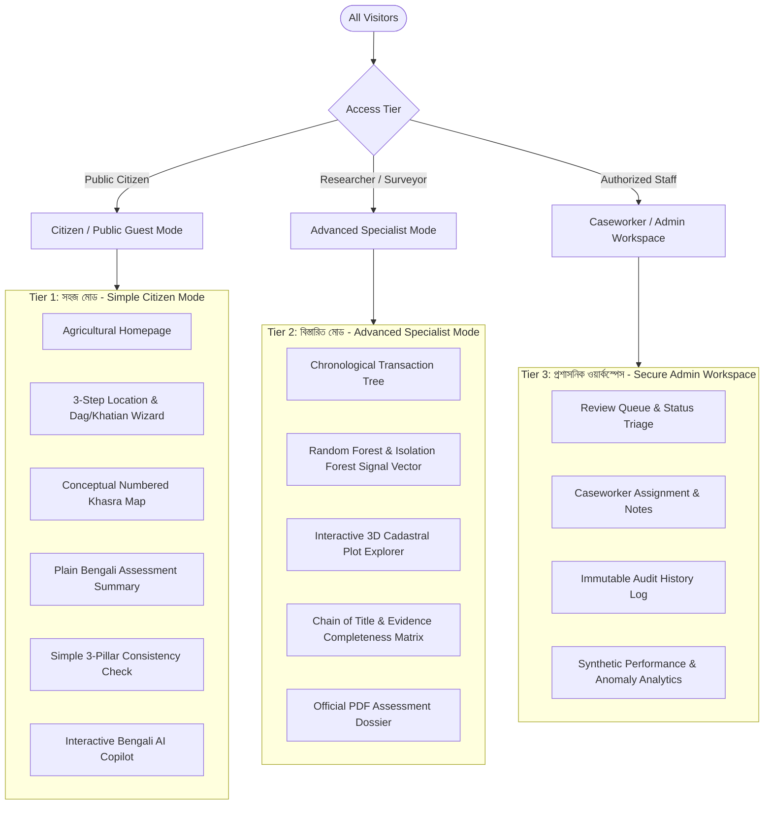

# LANDGUARD AI — PRODUCT INFORMATION ARCHITECTURE (IA)

**Product Name:** LandGuard AI — স্মার্ট ভূমি তথ্য ও লেনদেন যাচাই সহায়ক  
**Tagline:** "জমির তথ্য বুঝুন, লেনদেনের অসংগতি যাচাই করুন।" (Understand Land Records. Screen Transaction Inconsistencies.)  
**Design System:** LandGuard Greenfield (Human-Friendly Digital Land Experience)  
**Primary Principle:** *Simple outside. Powerful inside.*  

---

## 1. Persona & Tiered User Hierarchy

---

## 2. Global Navigation & Route Structure

| Route | View Name (Bengali) | Primary Purpose & Features | Access Tier |
| :--- | :--- | :--- | :--- |
| **`/`** | **হোমপেজ (Homepage)** | Welcoming agricultural hero, 8 primary service tiles, guest demo entry, quick search bar. | Public / All |
| **`/search`** | **জমি অনুসন্ধান (Land Search)** | Cascading Division &rarr; District &rarr; Upazila &rarr; Mouza &rarr; Dag/Khatian wizard. | Public / All |
| **`/khasra-map`** | **ডিজিটাল খসড়া ম্যাপ (Digital Khasra)** | Numbered schematic cadastral plot diagrams, boundary outlines, Google Maps context, plot inspector. | Public / All |
| **`/explorer-3d`** | **৩ডি ল্যান্ড এক্সপ্লোরার (3D Explorer)** | Procedural Three.js cadastral plot block explorer with rotation, zooming, and wireframe views. | Public / All |
| **`/transactions`** | **লেনদেন তালিকা (Transactions)** | Chronological transaction directory, scenario tags, amount and date filters. | Public / All |
| **`/transactions/:id`** | **লেনদেনের বিবরণ (Transaction Detail)** | In-depth transaction breakdown, evidence indicators, seller-buyer chain. | Public / All |
| **`/parcels/:id`** | **জমির ইতিহাস (Parcel Timeline)** | Parcel attributes, recorded acreage, prior transactions, mutations, ownership shares. | Public / All |
| **`/assess/:id`** | **AI যাচাই (AI Assessment)** | Simple vs. Advanced dual-mode evaluation (RF, IsoForest, rule-based flags). | Public / All |
| **`/rmd`** | **RMD ত্রিভুজ অডিট (RMD Discrepancy)** | Triangulation audit between Record of Rights (Khatian), Mutation (Namjari), and Deed (Dalil). | Public / All |
| **`/reviews`** | **রিভিউ ওয়ার্কস্পেস (Review Workspace)** | Authorized case triage (`UNREVIEWED`, `IN_REVIEW`, `APPROVED`, `REJECTED`), reviewer notes. | Reviewer / Admin |
| **`/reports`** | **প্রতিবেদন কেন্দ্র (Report Center)** | Downloadable cadastral assessment reports, PDF dossier exporter with ReportLab. | Public / Auth |
| **`/help`** | **সহায়তা কেন্দ্র ও গাইড (Help & Glossary)** | Bengali glossary (খতিয়ান, দাগ, মৌজা, খারিজ), FAQ, step-by-step guidance. | Public / All |
| **`/login`** | **প্রবেশ ও ডেমো (Login & Demo)** | Secure Argon2id reviewer login, role session handling, and guest demo overview. | Public / Auth |

---

## 3. Two Progressive Experience Modes

1. **সহজ মোড (Simple Mode — Default):**
   - Plain language explanations: "পর্যালোচনা প্রয়োজন" (Review Required), "তথ্য অসম্পূর্ণ" (Incomplete Data), "কোনো দৃশ্যমান অসংগতি নেই" (No Discrepancies Found).
   - Hidden raw machine learning feature vectors, complex decision scores, and database IDs.
   - High visual contrast, large click targets, and clear next steps.
2. **বিস্তারিত মোড (Advanced Mode):**
   - Toggleable switch at the top of assessment and transaction pages.
   - Exposes Isolation Forest anomaly score (-1 vs +1, decision score float), Random Forest tree feature weights, and exact evidence rule triggers.
   - Retains current state when toggling back and forth.

---

## 4. Grounding & Disclaimers

Every public page carries the clear, transparent LandTech disclaimer:
> **"এটি একটি সিন্থেটিক ডেটা-ভিত্তিক প্রদর্শন ও সিদ্ধান্ত সহায়ক প্ল্যাটফর্ম। এটি কোনো সরকারি আইনি মালিকানার সনদ প্রদান করে না।"**  
> *(This is a synthetic-data demonstration and human-review decision-support system. It does not provide legal title certification or government endorsement.)*
