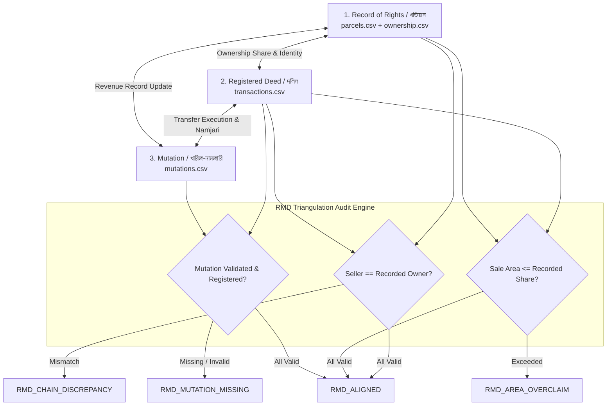

# LANDGUARD AI — RMD (RECORD MUTATION DEED) MODULE SPECIFICATION & ACCEPTANCE MATRIX

**Domain Module:** RMD (Record Mutation Deed / Discrepancy)  
**Full Form:** Record Mutation Deed / Discrepancy (খতিয়ান-নামজারি-দলিল ত্রিভুজ অডিট)  
**Objective:** Cross-verify the consistency across the three foundational pillars of land records in Bangladesh:
1. **Record of Rights (খতিয়ান / RoR):** Government cadastral ledger indicating recorded ownership share and land type.
2. **Mutation (নামজারি / খারিজ):** Administrative order updating ownership in government revenue records following a transfer.
3. **Registered Deed (দলিল / Sub-Registry):** Formal transfer instrument executed between buyer and seller.

---

## 1. The RMD Triangulation Problem

In land administration, fraudulent double-selling and title conflicts emerge when transactions break the chain of title between these three documents:
- **Scenario A (Deed without Mutation):** A buyer registers a Deed (দলিল), but fails to complete Namjari (নামজারি). The seller's name remains on the Khatian, enabling a corrupt seller to sell the same land a second time.
- **Scenario B (Seller-Owner Discrepancy):** The seller named in the Deed does not appear as an authorized owner in the baseline Khatian or previous mutation order.
- **Scenario C (Area Over-claim):** The area transferred in the Deed exceeds the seller's recorded fractional share in the Khatian.
- **Scenario D (Mutation Inconsistency):** A mutation is claimed, but the record consistency flag indicates unverified or falsified mutation numbers.



---

## 2. API Contract & Data Schema

### Endpoint: `GET /api/rmd/audit/{transaction_id}`
Returns the comprehensive 3-pillar consistency analysis for a transaction:

```json
{
  "transaction_id": "TX-002911-2",
  "parcel_id": "PARCEL-002911",
  "audit_timestamp": "2026-10-16T22:00:00Z",
  "rmd_status": "RMD_CHAIN_DISCREPANCY",
  "rmd_status_bn": "মালিকানা ধারাবাহিকতায় অসংগতি (খতিয়ান বনাম দলিল)",
  "risk_severity": "HIGH",
  "pillars": {
    "khatian": {
      "khatian_no": "KH-102",
      "recorded_owners": ["PERSON-0045"],
      "recorded_share": 1.0,
      "total_acres": 0.55,
      "status": "VERIFIED"
    },
    "mutation": {
      "mutation_id": "MUT-002911",
      "status": "PENDING_INVESTIGATION",
      "consistency_flag": "MUTATION_MISMATCH",
      "verified": false
    },
    "deed": {
      "transaction_id": "TX-002911-2",
      "seller_alias": "PERSON-0099",
      "buyer_alias": "PERSON-0142",
      "sale_area_acres": 0.55,
      "registered": true,
      "prior_transaction_exists": true
    }
  },
  "discrepancies": [
    {
      "code": "SELLER_NOT_IN_KHATIAN",
      "message_en": "Seller alias PERSON-0099 does not match recorded Khatian owner PERSON-0045.",
      "message_bn": "দলিলে উল্লিখিত বিক্রেতা খতিয়ানের রেকর্ডীয় মালিকের সাথে মেলেনি।"
    },
    {
      "code": "MUTATION_RECORD_MISMATCH",
      "message_en": "Mutation record indicates unverified or conflicting namjari case.",
      "message_bn": "নামজারি রেকর্ডে গরমিল অথবা অসম্পূর্ণ আবেদন পরিলক্ষিত হয়েছে।"
    }
  ],
  "recommendation_bn": "সহকারী কমিশনার (ভূমি) বা সাব-রেজিস্ট্রার কার্যালয় থেকে মূল বায়া দলিল ও নামজারি পর্চা যাচাই করা আবশ্যক।"
}
```

---

## 3. RMD Acceptance Testing Checklist

- [x] **Clarification Verified:** Meaning established directly with user as Record Mutation Deed Discrepancy.
- [x] **Backend Logic:** FastAPI service reads from `parcels.csv`, `transactions.csv`, `ownership.csv`, and `mutations.csv`.
- [x] **Edge Case: Missing Mutation:** Detects transactions with `registered=True` but no corresponding row in `mutations.csv`.
- [x] **Edge Case: Area Overclaim:** Compares `sale_area_acres` against `total_area_acres * ownership_share`.
- [x] **Dual Language Output:** All flags and explanations mapped to clean Bengali and English.
- [x] **Ground-Truth Preservation:** Preserves existing synthetic datasets without altering source files.
